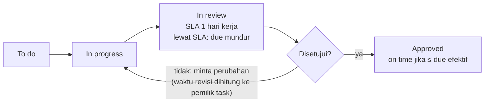
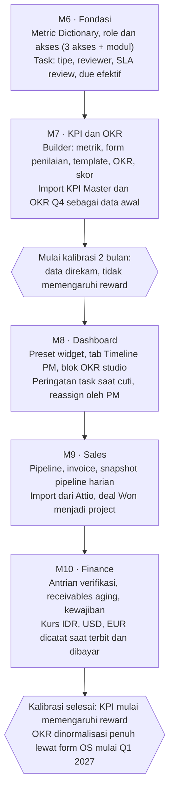

# PRD Phase 2 · Odama OS

22 Oktober 2026 · Rafi

## Ringkasan

Phase 2 menjadikan Odama OS satu-satunya sumber kebenaran untuk kerja, kinerja, penjualan, dan keuangan studio. Fokusnya lima hal: angka yang konsisten di semua dashboard, task sebagai dasar KPI, KPI & OKR builder yang bisa disusun HR sendiri, modul Sales, dan dashboard Finance.

**Latar belakang.** Phase 1 (M0–M5) sudah menghasilkan dashboard C-level, PM, HR, dan Desainer. Review dashboard menemukan angka yang saling bertentangan, misalnya jam kerja anggota yang berbeda di dua dashboard dan utilization yang ikut menghitung role non-billable. KPI dan OKR masih dikelola di dokumen terpisah dengan format, periode, dan arah target yang tidak seragam.

**Tujuan Phase 2**

1. Setiap angka punya satu definisi dan hasil yang sama di semua dashboard.
2. Task di OS menjadi dasar resmi KPI. Tidak ada lagi KPI yang dihitung dari Slack atau spreadsheet.
3. HR bisa menyusun, mengubah, dan menghapus KPI dan OKR sendiri, tanpa developer, dari data yang ada di OS.
4. Sales mengelola pipeline dan invoice di OS, menggantikan Attio.
5. Finance punya dashboard operasional untuk piutang, verifikasi pembayaran, dan kewajiban.

**Prinsip desain**

- **Berbasis role, bukan orang.** Aturan menempel ke role. Orang di-assign ke role.
- **Fleksibel, tapi dari data sistem.** KPI dan KR disusun dari data OS. Input manual hanya dipakai bila datanya belum ada, dan wajib disertai bukti.
- **Sederhana dan bisa dinormalisasi.** Semua metrik dikonversi ke skor 0–100 dengan aturan yang sama.

## Scope

| Area | Masuk Phase 2 | Pengguna utama |
| --- | --- | --- |
| Metric Dictionary | Definisi tunggal untuk semua angka di dashboard | Semua role |
| Task | Status, tipe task, reviewer + SLA, aturan due date | Semua role |
| KPI & OKR builder | Metrik, form penilaian, template, OKR, skor, grade | HR, Manager, semua anggota |
| Role & akses | 3 akses + modul + relasi | Admin, HR |
| Cuti & kapasitas | Peringatan task saat cuti, reassign oleh PM | PM, HR |
| Revisi dashboard | Desainer, PM, C-level, HR | Semua role |
| Sales | Pipeline, report bulanan, tabel invoice | Account Lead |
| Finance | Dashboard operasional, verifikasi pembayaran | Finance |

**Non-goals Phase 2**

- Pengganti Slack untuk chat. Slack tetap dipakai untuk komunikasi; tidak ada standup di Slack.
- Payroll dan perhitungan pajak otomatis. Finance hanya melihat jadwal kewajiban.
- Integrasi otomatis ke Dribbble, Upwork, atau Awwwards. Datanya diinput manual dengan link bukti.
- Normalisasi penuh isi OKR Q4 2026. OKR Q4 di-import apa adanya dan masuk masa kalibrasi.
- KPI untuk role Founder/Executive dan Finance.

## Role & akses

Role dipecah menjadi 4 dimensi supaya OS cukup punya 3 role akses, dan jabatan baru bisa ditambah tanpa kode baru.

| Dimensi | Menentukan | Isi | Ada logika di sistem |
| --- | --- | --- | --- |
| Akses | Apa yang boleh dilihat dan diubah | Admin, Manager, Member + modul | Ya |
| Divisi | Template KPI dasar dan widget default | Design, Development, Project, Sales, People, Finance, Executive | Sedikit |
| Level | Besarnya target | 1 Junior Staff · 2 Senior Staff · 3 Specialist · 4 Expert · 5 Lead/Director | Skala target saja |
| Jabatan | Label di profil | Teks bebas (Art Director, Lead PM, dll.) | Tidak ada |

**Akses**

- **Admin:** semua akses dan pengaturan sistem. Bisa diberikan per orang, terpisah dari jabatan.
- **Manager:** melihat data orang di bawahnya, assign task, review, dan mengusulkan OKR tim.
- **Member:** data sendiri dan project yang diikuti.

**Modul** (dicentang per orang, di atas akses):

- **People:** absensi, cuti, dan kelola KPI & OKR. Hanya pemegang modul ini yang boleh mengubah definisi KPI.
- **Finance:** invoice, verifikasi pembayaran, expense, piutang.
- **Sales:** pipeline, deal, invoice.
- **Laporan Studio:** keuangan studio dan KPI semua orang.

**Relasi, bukan role.** Siapa menilai dan siapa approve ditentukan dari relasi: atasan langsung, reviewer task, anggota project yang sama, atau penilai yang ditunjuk di KPI. Tidak ada role khusus untuk "penilai".

**Visibilitas KPI.** Orang itu sendiri, atasan langsung, pemegang modul People, dan pemegang modul Laporan Studio. Semua perubahan KPI tercatat di log, termasuk yang dilakukan Admin.

Daftar role awal (17 role, dengan divisi, level, template KPI, dan status OKR) ada di [KPI Master](https://docs.google.com/spreadsheets/d/1UECuYYOJOvCp-ChpbtplScD4BOMppGRPbkR_DHJzlVs/edit), tab Role.

## Metric Dictionary & konsistensi

Setiap angka di dashboard wajib merujuk ke satu definisi di Metric Dictionary. Dua dashboard yang menampilkan metrik yang sama harus menghasilkan angka yang sama.

**Definisi dasar**

| Istilah | Definisi resmi |
| --- | --- |
| Minggu | Senin–Jumat. Task yang due Sabtu/Minggu masuk minggu yang sama |
| Logged hours | Jam di timesheet dengan tanggal di periode itu, termasuk non-billable |
| Billable | Jam yang tercatat di project klien berstatus billable |
| Utilization | Jam billable ÷ kapasitas, **hanya untuk role billable** (Design, Development, Project) |
| Kapasitas | Jam kerja kontrak per minggu dikurangi cuti dan libur nasional |
| Workload | Total estimasi task yang due di periode itu ÷ kapasitas. Label harus berbeda dari utilization |
| On time | Task approved ≤ due efektif (lihat bagian Task) |
| Overdue | Task belum approved dan due efektif sudah lewat |
| Delayed (project) | Melewati end date atau punya task overdue |
| At risk (project) | Budget warning, ada task blocked, on hold, atau end date ≤ 7 hari dengan task terbuka |
| Margin (C-level) | Revenue − (people cost + operating cost), basis yang sama untuk revenue dan cost |

**Perbaikan konsistensi dari Phase 1**

1. Jam kerja di dashboard Desainer dan tabel tim PM memakai sumber dan definisi minggu yang sama.
2. Kartu "Team hours" dan panel "Team today" di dashboard PM menyebut jelas apakah jam PM sendiri ikut dihitung.
3. Utilization studio hanya menghitung role billable. Role lain ditampilkan terpisah.
4. Workload dan utilization diberi label dan warna berbeda. Workload yang dihitung dari task overdue yang menumpuk ditandai.
5. Task tanpa due date tidak ikut dihitung di "on time".
6. Margin proyek fixed-price yang masih berjalan ditampilkan sebagai **budget burn vs progres**, bukan margin negatif.
7. Revenue dan cost di satu kartu memakai basis yang sama (cash atau accrual), dan basisnya ditulis di kartu.
8. "Working today" di HR tidak lagi disamakan dengan "sudah log jam".

Katalog 24 metrik KPI (tipe, rumus, sumber data, pencatat) ada di [KPI Master](https://docs.google.com/spreadsheets/d/1UECuYYOJOvCp-ChpbtplScD4BOMppGRPbkR_DHJzlVs/edit), tab Katalog Metrik, dan menjadi data awal builder.

## Task sebagai sumber kebenaran

Task yang dihitung di KPI hanya task yang ada di OS. Setiap task wajib punya estimasi, due date, reviewer, dan status yang mengikuti alur di bawah.

**Field wajib**

| Field | Aturan |
| --- | --- |
| Estimasi | Minimal 1 jam. Pekerjaan lebih kecil digabung sebagai checklist |
| Due date | Wajib. Due date awal dikunci; perubahan butuh alasan |
| Reviewer | Wajib per task (PM, AD, CD, atau role lain yang ditunjuk) |
| Tipe | Regular, Revision, Bug, Report, Content (daftar bisa ditambah HR/Admin) |
| Link deliverable | Opsional; wajib untuk Output shot (link Figma) |

**Status:** To do → In progress → In review → Approved. Kalau reviewer minta perubahan, task kembali ke In progress.

**Aturan Task on Time (resmi)**

1. Task selesai = saat **approved**. Waktu revisi dihitung ke pemilik task.
2. SLA review = 1 hari kerja per putaran review.
3. Kelebihan waktu review di luar SLA ditambahkan ke due date. **Due efektif** = due date + total keterlambatan reviewer.
4. On time jika tanggal approved ≤ due efektif.
5. Perubahan due date dihitung hanya jika disetujui PM **sebelum** due date lewat. Setelah lewat, tetap dihitung telat.
6. Skor mingguan = task on time ÷ task yang due minggu itu. Skor periode = rata-rata skor mingguan, target ≥ 90%.
7. Minggu yang seluruhnya cuti atau libur tidak dihitung.

**Project revision.** Satu putaran = satu minggu yang berisi feedback klien untuk deliverable itu. Feedback berkali-kali dalam satu minggu tetap 1 putaran; minggu tanpa feedback tidak dihitung. PM mencatat feedback sebagai task tipe Revision yang terhubung ke deliverable.

**Untuk reviewer:** antrian review dengan hitung mundur SLA muncul di dashboard reviewer. Kalau SLA lewat, reviewer dan PM mendapat notifikasi, dan PM bisa memindahkan review ke reviewer lain. Kecepatan review diukur sebagai metrik Review Turnaround, mulai dipakai setelah masa kalibrasi.

## KPI & OKR builder

HR menyusun KPI dan OKR sendiri lewat UI dari 4 komponen. Tidak ada daftar KPI yang di-hardcode; isi [KPI Master](https://docs.google.com/spreadsheets/d/1UECuYYOJOvCp-ChpbtplScD4BOMppGRPbkR_DHJzlVs/edit) menjadi library awal yang bisa diduplikat dan diedit.

### 1. Metrik

Dibuat lewat 4 langkah berbentuk pertanyaan:

| Langkah | Pertanyaan | Pilihan |
| --- | --- | --- |
| Data | Mau menghitung apa? | Task, Output (shot/konten), Ide, Project, Absensi, Timesheet, Release, Testimoni, Form penilaian, Input manual + bukti |
| Saring | Yang mana saja? | Tipe, tag, status, tepat waktu, role, project |
| Hitung | Dengan cara apa? | Jumlah, persentase (bagian ÷ total), rata-rata, rating |
| Arah | Mana yang lebih baik? | Lebih besar, lebih kecil, dicatat saja |

Setiap metrik otomatis punya kalimat penjelas ("Jumlah task tipe Content yang approved, per minggu") dan preview dari data nyata bulan lalu. Metrik input manual diberi penanda "belum otomatis".

### 2. Form penilaian

Untuk metrik rating (Collaboration, Visual Consistency, Technical Reliability, Internal Team). HR menyusun kriteria dan deskripsi skala 1–5, lalu memilih:

- **Penilai:** atasan, diri sendiri, rekan di project yang sama, atau role tertentu. Untuk "rekan di project yang sama", sistem memilih otomatis anggota yang punya task atau log time di project yang sama minggu itu; kalau lebih dari satu, nilainya dirata-rata.
- **Frekuensi:** mingguan atau bulanan.
- **Aturan:** komentar wajib untuk nilai < 3. Periode tanpa penilai tidak dihitung.
- **Self-assessment:** penilai = diri sendiri, approver = HR (untuk Lead PM, Creative Director, Art Director).

### 3. Template KPI

Template = kumpulan metrik + target + periode skor + bobot. Template dipasang ke **role** (inti + add-on) dan bisa di-override per orang. Tombol **Simulasi** menghitung skor template itu dengan data bulan lalu sebelum diaktifkan. Role tanpa KPI tetap punya menu KPI dengan empty state: "Kamu belum punya KPI. KPI ditetapkan oleh HR."

### 4. OKR

- Objective per kuartal, check-in bulanan, maksimal 5 objective × 5 KR (peringatan, bukan blokir).
- Tipe KR: Milestone, Jumlah, Persen, Lebih kecil lebih baik, Terhubung ke KPI.
- Sumber progres KR: metrik (otomatis), task yang di-link (progres milestone), atau input manual + bukti.
- KR Milestone wajib punya definisi selesai dan approver (atasan langsung).
- Objective bisa dimiliki lebih dari satu orang dan dikaitkan ke OKR studio (2–3 objective per kuartal dari C-level).
- Manager mengusulkan OKR tim; HR menyetujui. Anggota mengisi OKR sendiri dalam batas aturan.

### Skor dan grade

| Tipe metrik | Skor 0–100 |
| --- | --- |
| Lebih besar lebih baik | min(100, aktual ÷ target × 100) |
| Lebih kecil lebih baik | aktual ≤ target → 100; selain itu target ÷ aktual × 100 |
| Rating 1–5 | rata-rata ÷ 5 × 100, lalu dibandingkan dengan target seperti "lebih besar" |
| Milestone | selesai 100, belum 0, atau progres checklist |
| Dicatat saja | tidak masuk skor |

Skor KPI = Σ(bobot × skor) ÷ Σ bobot, hanya metrik yang punya data. Rasio dihitung bulanan; jumlah berperiode panjang tampil sebagai progres dan dinilai di grade semester. Grade bulanan dipakai untuk coaching, grade semester untuk bonus. OKR tidak memengaruhi reward.

| Skor | Grade | Tindakan |
| --- | --- | --- |
| 84–100 | A · Sangat Baik | Lanjut, bila memungkinkan bonus |
| 67–83 | B · Baik | Evaluasi ringan |
| 50–66 | C · Cukup | Monitoring + 1-on-1 |
| 34–49 | D · Kurang | Coaching terjadwal + rencana perbaikan |
| 0–33 | E · Buruk | Coaching atau pemindahan task |

### Siklus hidup dan pengaman

- **Status:** Draft → Aktif (berlaku mulai periode berikutnya) → Arsip. Setiap perubahan diberi versi; skor lama tidak berubah.
- **Kalibrasi 2 bulan** otomatis untuk template baru, role baru, atau orang yang pindah/naik role: data direkam, tidak memengaruhi reward.
- **Peringatan (tidak memblokir):** bobot rating > 30%, lebih dari 5 objective, metrik tanpa data 30 hari, target jauh dari data historis, KR milestone tanpa definisi selesai.
- **Keberatan:** diajukan di OS maksimal 7 hari setelah dicatat, diputuskan HR bersama atasan langsung.
- **Pro-rata:** target jumlah proporsional untuk part-time, karyawan baru, dan probation; target persen tetap.

## Cuti & kapasitas

Sistem memberi peringatan untuk task yang due saat pemiliknya cuti; PM yang memutuskan reassign. Tidak ada backup otomatis.

1. Saat cuti disetujui, kapasitas orang itu otomatis berkurang di minggu terkait.
2. Dashboard PM menampilkan peringatan per task: "Task *Forms & validation* milik [anggota] due 26 Okt, saat [anggota] cuti 26–27 Okt."
3. PM memilih: assign ulang ke anggota lain, atau geser due date (alasan wajib, disetujui sebelum due date lewat).
4. Task yang di-assign ulang dihitung ke pemilik baru untuk KPI.
5. Peringatan juga muncul saat PM membuat task baru dengan due date di hari cuti pemiliknya.

## Revisi dashboard

Dashboard tidak lagi dibuat per role. Dashboard tersusun dari widget yang muncul otomatis berdasarkan tanggung jawab orang itu; empat dashboard Phase 1 menjadi preset awal.

| Kondisi | Widget yang muncul |
| --- | --- |
| Punya task | Kanban, to-do hari ini, log time (termasuk non-billable), skor KPI saya |
| Jadi reviewer | Antrian review + hitung mundur SLA |
| Punya anggota tim | Team today, peringatan cuti vs task, workload tim |
| Punya OKR | Progres OKR + jadwal check-in |
| Modul People | Agenda HR, leave requests, compliance, KPI semua orang |
| Modul Sales | Pipeline, invoice |
| Modul Finance | Piutang, verifikasi pembayaran, kewajiban |
| Modul Laporan Studio | Finance overview, studio utilization, project margins, OKR studio |

**Perubahan per preset**

- **Desainer:** kanban dan to-do list jadi tampilan utama. Bisa menambah log time untuk task non-billable. Kartu KPI mingguan dengan label Achieve/Tidak achieve.
- **PM:** tambah tab **Timeline** di samping kalender. Warna proyek dipisah dari warna status. Panel Project status tetap.
- **C-level / Laporan Studio:** dashboard yang ada tetap. Tambah blok **OKR studio**. Margin proyek fixed yang berjalan diganti budget burn vs progres. Avatar di kolom Members diberi inisial.
- **HR:** "Working today" diganti status kehadiran yang tidak bergantung pada log jam. Workload diberi label berbeda dari utilization. Tambah akses ke builder KPI & OKR.

## Sales

Pipeline adalah fitur utama modul Sales, menggantikan Attio. Deal yang menang otomatis menjadi client dan project.

### Pipeline

- **Stage default:** Lead → Qualified → Proposal sent → Negotiation → Won / Lost.
- **Stage fleksibel:** pengguna modul Sales bisa menambah, mengubah, dan menghapus stage. Setiap stage wajib punya kategori (Open, Won, Lost) dan probabilitas default. Stage yang masih berisi deal tidak bisa dihapus sebelum deal-nya dipindah.
- **Field deal:** client, nilai, mata uang (IDR, USD, EUR), probabilitas, expected close date, owner, sumber lead, jenis layanan, alasan kalah.
- **Won → Create project:** membuat Client dan Project dengan budget terisi.
- **Deal macet:** ditandai bila tidak berpindah stage lebih dari N hari (N diatur di pengaturan).
- **Migrasi:** import CSV dari Attio.
- **Kartu atas:** total pipeline, weighted pipeline (nilai × probabilitas), win rate, rata-rata durasi deal, lead baru bulan ini, invoice overdue.

### Report bulanan

- **Candle chart per bulan:** nilai pipeline open, high, low, close. Membutuhkan **snapshot nilai pipeline harian** yang mulai direkam sejak modul aktif; data sebelum itu tidak bisa dihitung mundur.
- **Pipeline bridge (waterfall) per bulan:** awal bulan + deal baru − lost − won = akhir bulan, untuk menunjukkan penyebab naik turunnya pipeline.
- Semua angka dihitung dari kategori stage, bukan nama stage.

### Invoice

| Kolom | Isi |
| --- | --- |
| No. invoice, client, project | Dari project yang terhubung |
| Tipe | DP / termin / final |
| Nominal + mata uang | IDR, USD, EUR; kurs ke IDR dicatat saat terbit dan saat dibayar |
| Platform | Xendit, transfer bank, Wise, PayPal, lainnya |
| Tanggal kirim, jatuh tempo | — |
| Status | Sent → Payment submitted → Paid, atau Overdue |
| Bukti bayar, tanggal bayar | Upload oleh Sales |

Sales membuat invoice dan meng-upload bukti bayar; status berubah menjadi Payment submitted. Finance memvalidasi: Paid, atau ditolak kembali ke Sent dengan catatan. Pembayaran lewat Xendit otomatis Paid lewat webhook. Revenue baru dihitung setelah status Paid.

## Finance

Dashboard Finance bersifat operasional: apa yang harus dikerjakan hari ini. Dashboard C-level tetap untuk tren dan margin.

- **Kartu atas:** kas masuk bulan ini, piutang jatuh tempo minggu ini, bukti bayar menunggu verifikasi, expense menunggu approval.
- **Antrian verifikasi:** bukti bayar dari Sales dicocokkan ke rekening, lalu ditandai Paid atau ditolak dengan catatan.
- **Receivables aging:** piutang per client dikelompokkan 0–30, 31–60, dan > 60 hari.
- **Kalender kewajiban:** payroll, BPJS, deadline pajak (tanggal bisa diatur), dan jatuh tempo invoice. Payroll dan BPJS memakai data kalender HR yang sama.
- **Kurs:** invoice USD/EUR mencatat kurs saat terbit dan saat dibayar; selisih kurs tercatat. Semua laporan ditampilkan dalam IDR.

## Model data

Phase 2 menambah entitas berikut di Supabase. Semua entitas KPI/OKR diberi versi dan tanggal berlaku.

| Area | Entitas | Catatan |
| --- | --- | --- |
| Role | role, member_role, module_grant | role = divisi + level + jabatan; akses dan modul per orang |
| Task | task_type, review_round | review_round mencatat submit, approve/reject, dan SLA |
| Output | output (shot, konten), idea, support_request, qc_record, error_log, release, testimony, challenge | Sumber data metrik log di OS |
| Kehadiran | attendance, leave | Leave mengurangi kapasitas |
| KPI | metric, rating_form, rating_response, kpi_template, kpi_item, kpi_assignment, kpi_result | kpi_result = snapshot skor per periode |
| OKR | okr_cycle, objective, objective_owner, key_result, kr_link, kr_checkin | kr_link ke metrik atau task |
| Sales | pipeline_stage, deal, pipeline_snapshot, invoice, payment_proof | snapshot harian untuk candle chart |
| Finance | expense, obligation, fx_rate | fx_rate per tanggal |
| Audit | change_log | Semua perubahan definisi KPI/OKR dan akses |

Metrik disimpan sebagai definisi (sumber data + saring + cara hitung + arah), bukan sebagai kode. Mesin perhitungan membaca definisi itu, sehingga metrik baru tidak butuh deploy.

## Rollout & kalibrasi

Fondasi data dan builder dibangun lebih dulu karena semua modul lain membaca definisi metrik dan aturan task yang sama. Masa kalibrasi 2 bulan dimulai begitu builder aktif dan berjalan paralel dengan M8–M10.

Penomoran M6–M10 melanjutkan Phase 1 (M0–M5); urutan ini usulan dan tanggalnya belum ditetapkan.

## Success metrics

| Metrik | Target | Diukur |
| --- | --- | --- |
| Angka yang sama di semua dashboard | 0 selisih untuk metrik yang sama | Cek otomatis tiap minggu |
| Task dengan estimasi, due date, dan reviewer lengkap | ≥ 95% | Akhir masa kalibrasi |
| KPI yang dihitung otomatis dari data OS | ≥ 70% dari semua item KPI aktif | Akhir masa kalibrasi |
| Metrik/template KPI yang dibuat HR tanpa developer | 100% perubahan setelah go-live | Change log |
| Review selesai dalam SLA 1 hari kerja | Baseline di masa kalibrasi, lalu target ditetapkan | Review Turnaround |
| Lead masuk pipeline OS | 100%, Attio tidak dipakai lagi | 1 bulan setelah modul Sales aktif |
| Invoice terverifikasi Finance ≤ 2 hari kerja setelah bukti diupload | ≥ 90% | Bulanan |

## Open questions

- [ ] Target Expert Designer setelah kategori ide digabung: Skill Contribution ≥ 6/bulan (default sekarang) atau target per tag?
- [ ] KPI Senior Web Developer: ditunda, menunggu dokumen dari HR.
- [ ] Daftar report wajib PM untuk Timely Reporting: ditunda, sementara memakai report yang sudah ada.
- [ ] Add-on KPI Creative Director: sementara memakai Design Core saja.
- [ ] Ambang "deal macet" (N hari) di pipeline Sales.
- [ ] Basis revenue dan cost di dashboard C-level: cash atau accrual?
- [ ] Tanggal deadline pajak yang dimasukkan ke kalender kewajiban Finance.
